Hi, I'm Alexander Hu, currently studying at UCLA. You may see my past and present coursework [here](https://github.com/alexanderhu77/Coursework). I am officially a computer science major, but my interests currently include the ___union___[^union] of theoretical computer science, theoretical statistics, and theoretical mathematics. However, I also regularly learn outside my interests. More formally and precisely:

```math
\mathcal{I}(\tau_0) \supseteq \mathrm{CS}_{T} \cup \mathrm{Stats}_{T} \cup \mathrm{Math}_{T} \supsetneq \mathrm{CS}_{T} \cap \mathrm{Stats}_{T} \cap \mathrm{Math}_{T}
```

```math
\iff \big(\forall s : \; s \in \mathrm{CS}_{T} \cup \mathrm{Stats}_{T} \cup \mathrm{Math}_{T} \implies s \in \mathcal{I}(\tau_0)\big) \;\land\; \big(\mathrm{CS}_{T} \cup \mathrm{Stats}_{T} \cup \mathrm{Math}_{T}\big) \setminus \big(\mathrm{CS}_{T} \cap \mathrm{Stats}_{T} \cap \mathrm{Math}_{T}\big) \neq \varnothing
```

```math
\forall \tau \geq \tau_0 : \; 0 \ll \mathbb{P}\big(X_\tau \notin \mathcal{I}(\tau)\big) \ll 1
```

```math
\text{where } \tau_0 = \text{now (November 16, 2026 UTC), }\ \mathcal{I}(\tau) = \text{my interests at time } \tau\text{,}
```

```math
\mathrm{CS},\ \mathrm{Stats},\ \mathrm{Math} = \text{the sets of subjects in computer science, statistics, and mathematics, respectively,}
```

```math
X_\tau = \text{a randomly chosen subject I learn at time } \tau\text{, }\ \text{and the subscript } T \text{ denotes ``theoretical''}
```

<br>

I've worked with Python, C/C++, Java, JavaScript, TypeScript, SQL, Scala, R, and Assembly.

Beyond classes and side projects, I do cybersecurity work and security research. A small selection of it is documented in [my CVEs and advisories](https://github.com/alexanderhu77/Security).

Previously, I was a software engineer intern at MemVerge Inc., where I worked on reducing LLM serving costs.

Fun fact: I play a lot of chess and am a US Chess Candidate Master. [Crazyhouse](https://en.wikipedia.org/wiki/Crazyhouse) is my favorite chess variant[^bughouse]; here is my most recent Crazyhouse game:

<a href="https://lichess.org/LTdF9QtQ/black" title="Open this game on Lichess">
<picture>
  <source media="(prefers-color-scheme: dark)" srcset="https://raw.githubusercontent.com/alexanderhu77/alexanderhu77/chess-output/chess-replay-dark.svg">
  
</picture>
</a>

[^union]::bangbang:**NOT** the intersection :bangbang:
[^bughouse]:[Bughouse chess](https://en.wikipedia.org/wiki/Bughouse_chess) is a close second
